# JobTracker

A job application tracker built with React. Keep every application, interview and follow-up in one place, see how your job hunt is going at a glance, and save live remote jobs straight into your pipeline.

**Live demo:** https://job-application-tracker-zeta-gold.vercel.app

> Built for Milestone 3 (React: Modern UI Development), Option B: Job Application Tracker. Data is stored in your browser's LocalStorage, and the login is a simple name-only demo login.

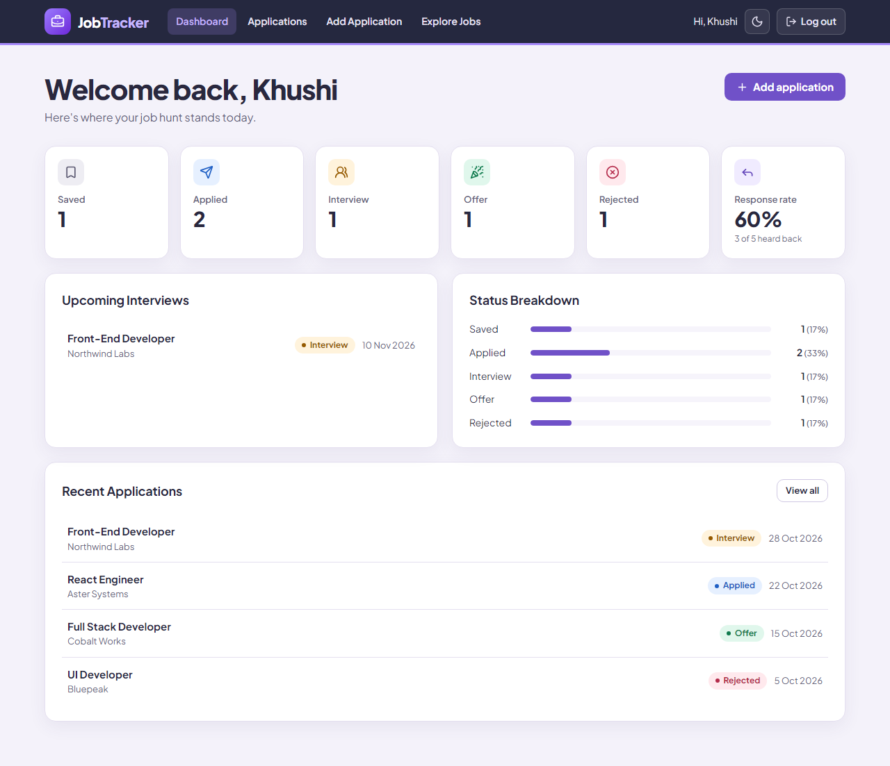

## Features

- **Applications:** add, edit and delete applications with company, role, status, applied date, salary range, location and notes.
- **Status pipeline:** move an application through Applied → Interview → Offer → Rejected directly from its card. Jobs saved from Explore Jobs start as Saved, and get an applied date when they enter the pipeline.
- **Dashboard:** counts per status, upcoming interviews, response rate % and recent applications.
- **Find anything:** filter by status, search by company or job title, and sort by date.
- **Application details:** full information plus a notes timeline of dated notes.
- **Explore Jobs:** live remote tech jobs from the [Remotive](https://remotive.com) and [Himalayas](https://himalayas.app) APIs, with a "Save to my tracker" button, loading skeletons, an error state with retry, and pagination.
- **Protected routes:** a fake login stores your name in Context. Without it, every page redirects to `/login`.
- **Polish:** designed empty states, confirm-before-delete modal, dark mode, and a responsive layout for mobile and desktop.

## Tech stack

React 19 · React Router 7 · Context API · Vite · hand-built CSS components · lucide-react icons · Vercel

No state libraries and no chart library. The status bars are plain CSS.

## Routes

| Route | Page | Access |
| --- | --- | --- |
| `/login` | Login | Public |
| `/dashboard` | Dashboard | Protected |
| `/applications` | Applications list | Protected |
| `/applications/new` | Add application | Protected |
| `/applications/:id` | Application detail (dynamic route) | Protected |
| `/applications/:id/edit` | Edit application (dynamic route) | Protected |
| `/explore-jobs` | Explore Jobs | Protected |

## Component tree

```text
App
└── ThemeProvider                     Context: theme
    └── AuthProvider                  Context: logged-in user's name
        └── ApplicationProvider       Context: all applications
            └── Routes
                ├── Login
                │   ├── ThemeToggle
                │   ├── FormField
                │   └── Button
                └── ProtectedRoute    no user → redirect to /login
                    └── Layout        shared; renders once
                        ├── Navbar
                        │   └── ThemeToggle
                        └── <Outlet>  pages swap here
                            ├── Dashboard
                            │   ├── PageHeader, Button
                            │   ├── StatCard (×6)
                            │   └── Panel (×3)
                            │       ├── ApplicationList → StatusBadge
                            │       ├── StatusBreakdown
                            │       └── EmptyState
                            ├── Applications
                            │   ├── PageHeader, Button
                            │   ├── ApplicationFilters
                            │   ├── ApplicationCard (list)
                            │   │   ├── StatusBadge, StatusSelect
                            │   │   └── Button
                            │   ├── EmptyState
                            │   └── ConfirmDialog
                            ├── ApplicationFormPage (add + edit)
                            │   ├── PageHeader, Panel
                            │   └── ApplicationForm → FormField, Button
                            ├── ApplicationDetails
                            │   ├── PageHeader, Button, ConfirmDialog
                            │   └── Panel (×2)
                            │       ├── StatusBadge, StatusSelect
                            │       └── NotesTimeline
                            │           └── FormField, EmptyState, ConfirmDialog
                            ├── ExploreJobs
                            │   ├── PageHeader, Button
                            │   ├── JobCardSkeleton (loading) → Skeleton
                            │   ├── JobCard (list) → Button
                            │   ├── EmptyState (error / no results)
                            │   └── Pagination
                            └── NotFound → EmptyState
```

## Where state lives, and why

| State | Location | Why |
| --- | --- | --- |
| Applications | `ApplicationProvider` (Context + LocalStorage) | Dashboard, Applications, Details, the form and Explore Jobs all read or change it. |
| Logged-in user | `AuthProvider` (Context + LocalStorage) | `ProtectedRoute`, `Navbar`, `Login` and `Dashboard` all need it. |
| Theme | `ThemeProvider` (Context + LocalStorage) | Must apply on every page, including Login, which has no Navbar. |
| Filters and sort | `Applications` page (lifted state) | `ApplicationFilters` edits them and the results list reads them, so they live in the closest shared parent. |
| Form values and errors | `ApplicationForm` (local) | Only the form cares until you submit. |
| New note text | `NotesTimeline` (local) | Nothing else needs it. |
| Mobile menu open | `Navbar` (local) | Nothing else needs it. |
| Fetched jobs, loading, error | `useRemoteJobs` hook | Only Explore Jobs uses them, and they come from the API rather than the user. |

Dashboard numbers are not stored at all. They are calculated from the applications on each render, so they can't get out of sync.

## Custom hooks

| Hook | Purpose |
| --- | --- |
| `useLocalStorage` | Works like `useState`, but saves to LocalStorage and survives a refresh. Falls back safely if stored data is corrupted. |
| `useRemoteJobs` | Fetches jobs from both APIs and returns `{ jobs, loading, error, refresh }`. Cancels requests on unmount and keeps working if one source is down. |
| `useApplications`, `useAuth`, `useTheme` | Read each Context, with a clear error if used outside its provider. |

## Reusable components

`Button`, `FormField`, `StatusBadge`, `StatusSelect`, `EmptyState`, `ConfirmDialog`, `Skeleton`, `PageHeader`, `Panel`, `StatCard`, `Pagination`, `ApplicationCard`, `ApplicationFilters`, `ApplicationForm`, `ApplicationList`, `NotesTimeline`, `StatusBreakdown`, `JobCard`, `JobCardSkeleton`, `ThemeToggle`

## Screenshots

| Applications | Application detail |
| --- | --- |
| 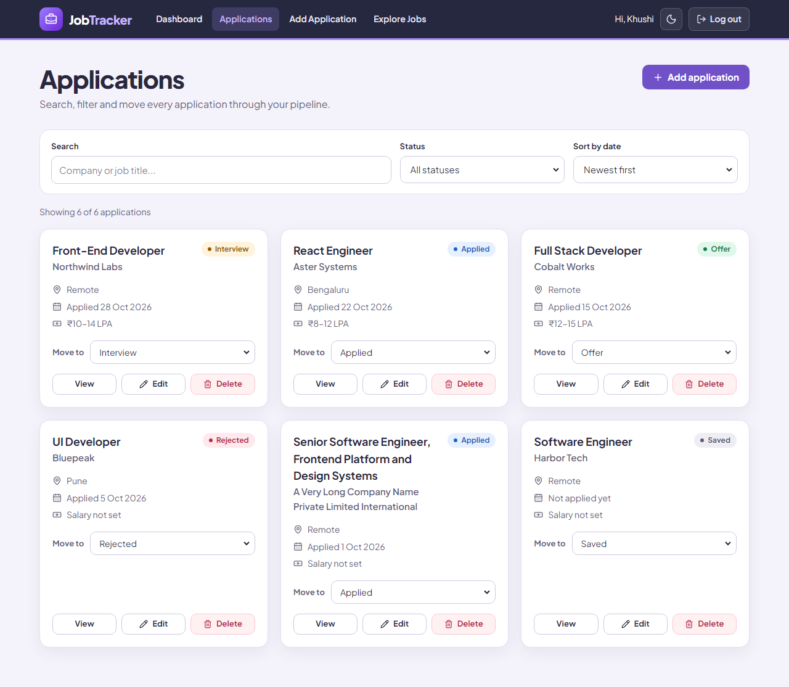 | 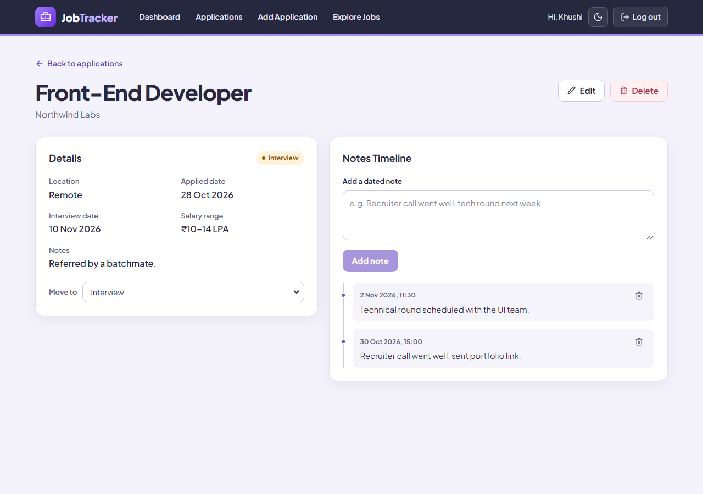 |

| Explore Jobs | Loading skeletons |
| --- | --- |
| 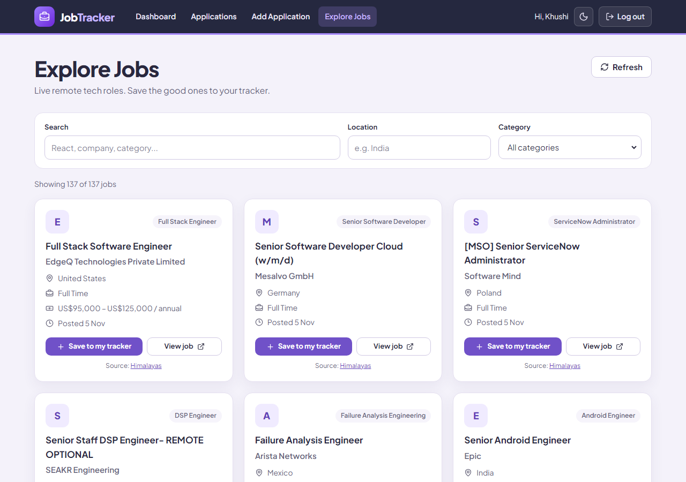 | 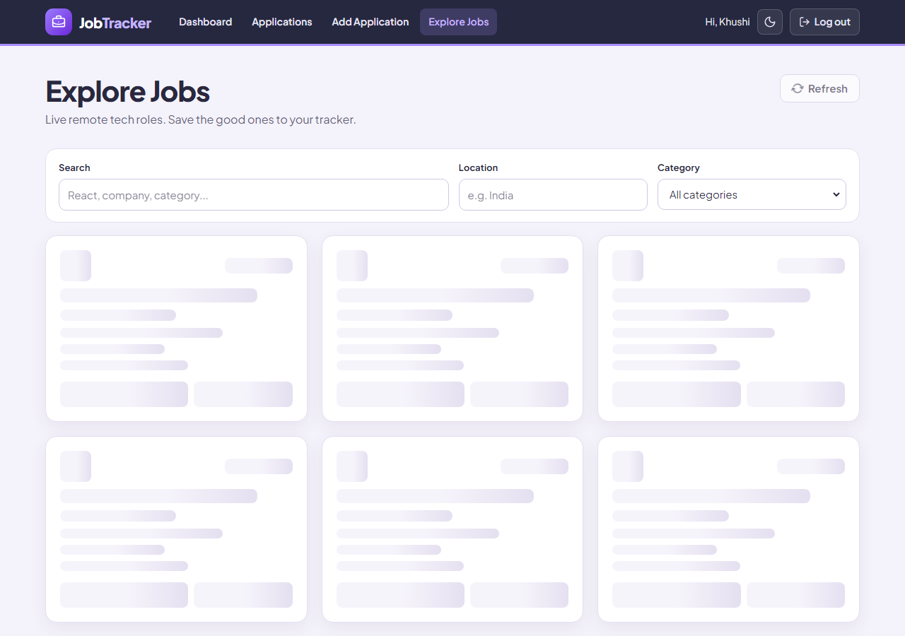 |

| Add / edit form | Empty state |
| --- | --- |
| 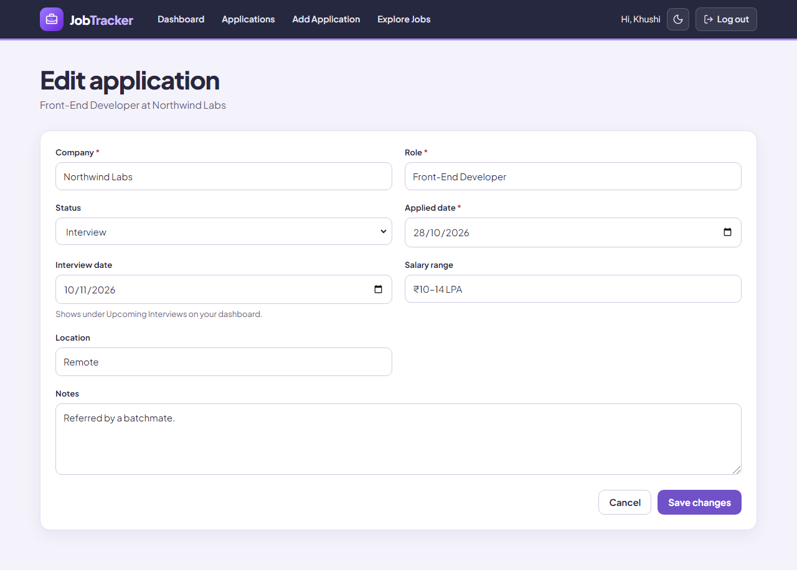 | 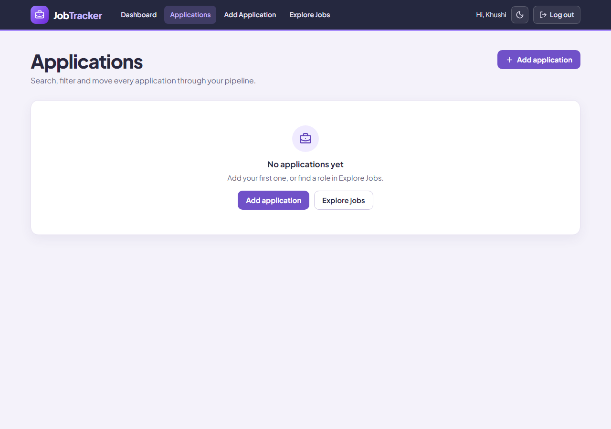 |

| Dark mode | Login |
| --- | --- |
| 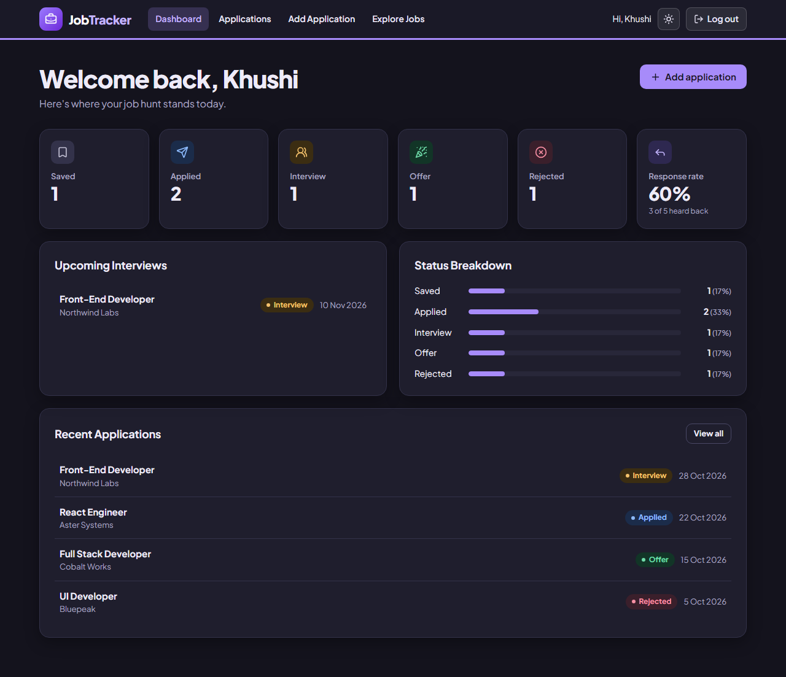 | 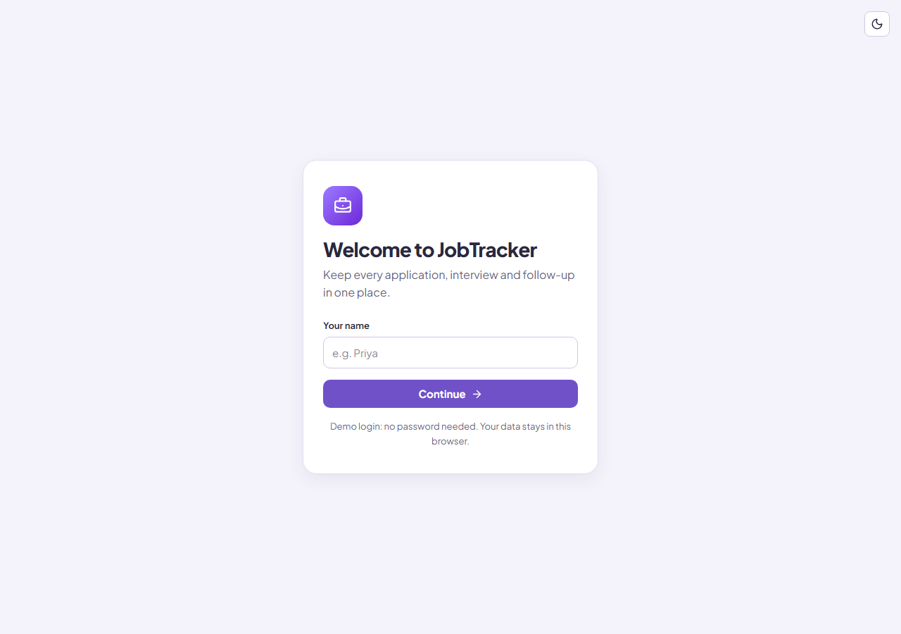 |

| Mobile | Mobile, dark mode |
| --- | --- |
| 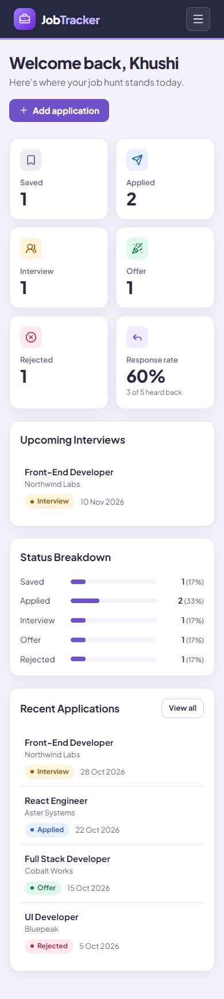 | 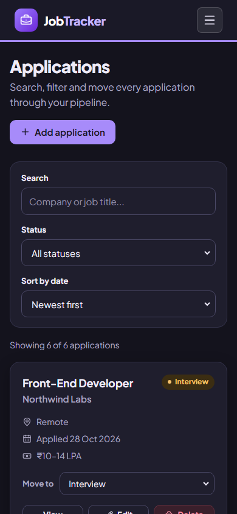 |

## Run it locally

```bash
git clone https://github.com/khushi898/job-application-tracker.git
cd job-application-tracker
npm install
npm run dev
```

| Command | What it does |
| --- | --- |
| `npm run dev` | Start the dev server |
| `npm run build` | Build for production |
| `npm run lint` | Run ESLint |

No API keys are needed. Himalayas doesn't allow direct browser requests, so its calls go through a proxy: `vite.config.js` in development and `vercel.json` in production.

## Job data

Job listings come from [Remotive](https://remotive.com) and [Himalayas](https://himalayas.app). Each listing credits its source and links back to the original posting.
